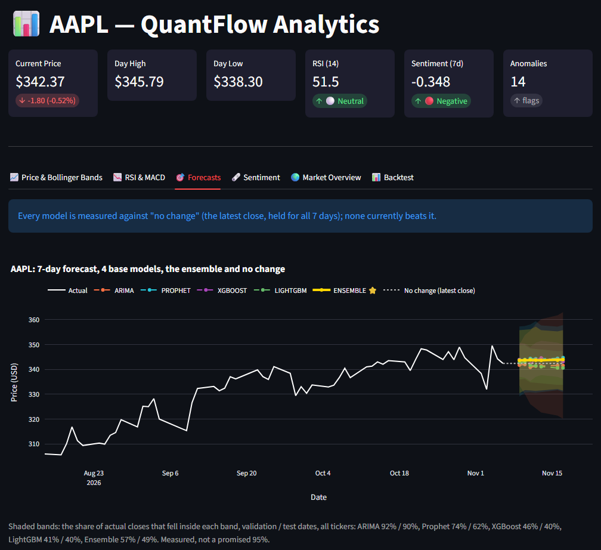
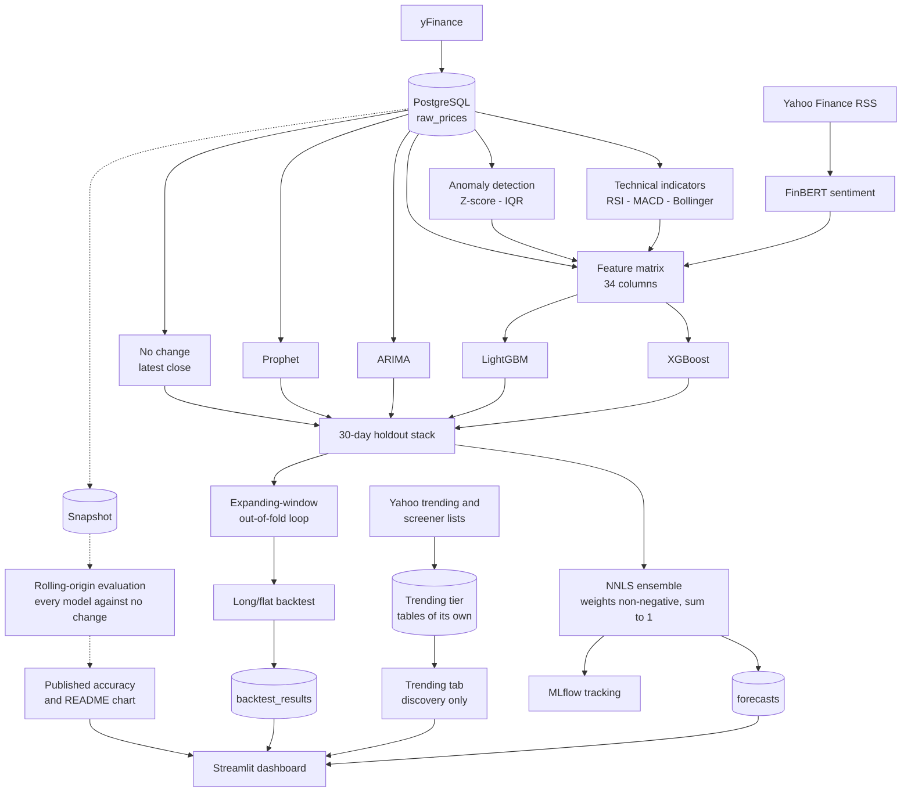
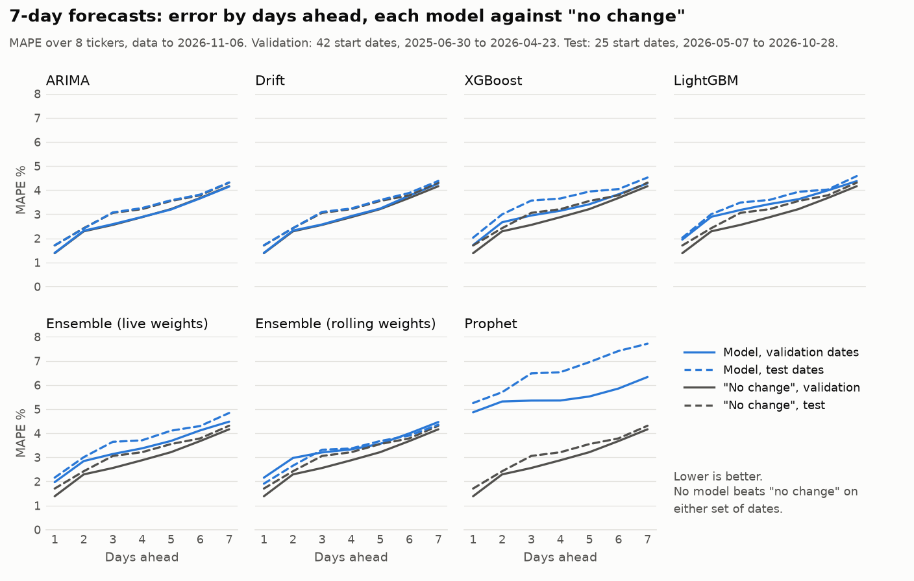

# QuantFlow

A stock analytics pipeline that ingests market data, engineers features from price, sentiment and anomaly signals, and forecasts 8 stocks 7 trading days ahead with five models, each measured against a "no change" baseline under a leakage-controlled evaluation harness. A separate, discovery-only tier tracks the stocks trending right now.

[](https://quantflow-analytics.streamlit.app)
[](https://www.python.org/)
[](https://supabase.com/)
[](https://mlflow.org/)
[](LICENSE)

**Live dashboard: [quantflow-analytics.streamlit.app](https://quantflow-analytics.streamlit.app)** (on the free tier it sleeps after 12 hours without visitors; the first visit wakes it)

> **Findings**
> - No model beats "no change" (every future close equals today's) on 7-day forecasts, on either the validation or the test dates: [Evaluation](#evaluation).
> - A data bug that invalidated the earlier published figures was found and fixed: from April 2026 each day's "close" was its 09:30 price ([the earlier figures](#the-2026-08-04-figures-and-why-they-were-replaced)).
> - Whether the news sentiment helps awaits its forward test, scored once after 2027-09-15 ([news](#does-the-news-help-not-enough-data-yet)).



*The dashboard's Forecasts tab (AAPL, data to 2026-11-06). Taken before the news switched to RSS only on 2026-11-09, so its sentiment card and the boosted trees' and the ensemble's lines still include NewsAPI's articles; its band figures equal the current ones.*

---

## What it does

- **Ingests** daily and 15-minute OHLCV bars for 8 tickers from yFinance into PostgreSQL, once a day after the US close, in a GitHub Actions workflow. An Alpha Vantage fetcher and a 15-minute APScheduler loop exist for local use; the daily workflow uses neither.
- **Computes** RSI(14), MACD(12/26/9), Bollinger Bands(20), rolling Z-score and IQR anomaly flags, and FinBERT sentiment over Yahoo Finance RSS headlines (NewsAPI's, fetched until 2026-11-09, no longer count).
- **Forecasts** 7 trading days ahead with five models: ARIMA, Prophet, XGBoost, LightGBM, and an NNLS stacking ensemble over the four and "no change", the boosted trees from a 34-column feature matrix.
- **Evaluates** every model on that 7-day task from 67 rolling start dates against "no change", and runs a long/flat strategy backtest on the ensemble.
- **Discovers** the stocks people are watching and trading heavily, from Yahoo's trending, most-active, gainer and loser lists, in a [trending tier](#trending-tier-discovery-only) of its own: daily prices, indicators, anomaly flags and sentiment for up to 15 of them, never forecast, ensembled, backtested or evaluated.

---

## Architecture



Data flows one way. `quantflow.models` depends on `quantflow.evaluation`, never the reverse, so scoring cannot come to depend on training internals. The trending tier reads and writes only its own tables, so nothing it stores can reach a model or the evaluation.

---

## Evaluation

The question: does any model forecast what the dashboard publishes, the closing price 1 to 7 trading days ahead, better than **"no change"**, the forecast that every future close equals today's? On these dates, **no**. ARIMA and drift cannot be told apart from it; the boosted trees, both ensembles and Prophet are measurably worse. Daily prices are close to a random walk, so this is a common result, reported as measured.

Data to 2026-11-06 (snapshot digest `f0c3957b`). Validation figures from run P4b (commit `c52b0ed`, MLflow `70495566`), test-date figures from run T4 (the same commit, MLflow `ad6d1694`), both of 2026-11-09, with news from RSS only ([news](#does-the-news-help-not-enough-data-yet)). Where each number comes from: [docs/evaluation.md, section 17](docs/evaluation.md#17-phase-4-the-published-results-2026-11-09).

### How it's measured

- **The published task.** At each start date, every model retrains on data before it and forecasts the next 7 trading days the way the live system does (the boosted trees feed each prediction back in as the next day's input). Nothing after the start date reaches a model.
- **Two sets of dates.** 42 validation start dates (2025-06-30 to 2026-04-23) and 25 test start dates (2026-05-07 to 2026-10-28), every 5 trading days, 8 tickers: 2,352 forecasts per model on the validation dates and 1,400 on the test dates. Every keep-or-drop decision used the validation dates only; the test dates are reported, never used to choose.
- **Metrics.** MAPE, the mean absolute percentage error. Skill: 1 minus a model's mean absolute error over "no change"'s, averaged over tickers, so above 0 would beat it. "Beats no change" rests on one test set in advance: each start date's difference in error from "no change", with Newey-West standard errors and a Holm correction across the models. Every other figure is descriptive.
- **Prices** are each trading date's daily close (see [the earlier figures](#the-2026-08-04-figures-and-why-they-were-replaced)). Drift is the latest close grown at the history's average daily return.

### Results

| Model | MAPE, validation | MAPE, test | Skill, validation | Skill, test | Beats "no change"? (p, validation / test) |
|---|---|---|---|---|---|
| **No change** | **2.88%** | **3.15%** | 0 | 0 | the baseline |
| ARIMA | 2.88% | 3.17% | -0.003 | -0.007 | no, no clear difference (0.79 / 0.41) |
| Drift | 2.93% | 3.19% | -0.011 | -0.010 | no, no clear difference (0.42 / 0.28) |
| XGBoost | 3.14% | 3.54% | -0.096 | -0.171 | no, worse (under 0.001 on both) |
| LightGBM | 3.35% | 3.52% | -0.177 | -0.170 | no, worse (under 0.001 on both) |
| Ensemble, live weights | 3.37% | 3.68% | -0.185 | -0.221 | no, worse (under 0.001 on both) |
| Ensemble, rolling weights (evaluation only) | 3.38% | 3.31% | -0.170 | -0.051 | no, worse (under 0.001 / 0.003) |
| Prophet | 5.51% | 6.58% | -0.906 | -1.096 | no, worse (under 0.001 on both) |

ARIMA and drift cannot be told apart from "no change"; every other model is worse by the test on both sets of dates. Some models come out ahead on individual tickers (ARIMA on 4 of 8 on the validation dates), but none overall.



Error grows with every day ahead ("no change" goes from 1.38% at 1 day to 4.16% at 7 on the validation dates), and no model gets clearly below "no change" at any horizon: ARIMA and drift stay within about 0.1 point of it. The chart is drawn by `evaluate publish` from the two runs.

### Forecast bands: measured coverage, not 95%

The shaded bands on the dashboard are not a promised range. On the same forecasts, the share of actual closes that fell inside each:

| Model | How the band is built | Validation | Test | Median width (validation) |
|---|---|---|---|---|
| ARIMA | statsmodels' 95% interval | 92% | 90% | 12.5% of the forecast |
| Prophet | Prophet's 95% interval (seeded) | 74% | 62% | 12.8% |
| XGBoost | the forecast plus or minus 2% | 46% | 40% | 4.0% |
| LightGBM | the forecast plus or minus 2% | 41% | 40% | 4.0% |
| Ensemble, live weights | its inputs' bounds, weighted like the forecast; "no change" has no band | 57% | 49% | 5.0% |
| Ensemble, rolling weights | the same | 62% | 46% | 7.0% |

Only ARIMA's comes close to what it claims. The bands stay as they are, labelled on the dashboard with these figures; a band for "no change" (a random walk's) is a later candidate, to be decided on fresh data.

### Does the news help? Not enough data yet

The boosted trees can use FinBERT sentiment from news headlines. Whether that helps cannot be measured yet: news is stored only from 2026-04-10 and no free archive reaches further back, so only 4.8% of the validation (ticker, start date) pairs had a real article, against the 50% set in advance as the minimum for the comparison. The news gets a forward test instead: 42 start dates from 2026-11-09, scored once after 2027-09-15, with the keep-or-drop rule written on 2026-11-09, before any start date is scored ([docs/evaluation.md, section 4](docs/evaluation.md#4-does-the-news-help-2d)).

From 2026-11-09 the features count Yahoo Finance's RSS articles only, the stored history included, so they mean the same before and after: NewsAPI's free plan is for development and testing only. NewsAPI had supplied 47% of the articles that counted; the coverage above is the same from RSS alone. The figures on this page were rerun after the switch (P4b and T4): on the validation dates, where news reaches only the last two start dates, only the last one's boosted-tree and ensemble forecasts changed; on the test dates the boosted trees and the ensembles moved by under 0.04 points of MAPE each, and no conclusion changed.

### What changed, and what looks worse on the test dates

- **Phase 2 (2026-11-08)** built this evaluation: the rolling start dates, "no change" and drift as baselines, news dated by when it became available, missing news kept missing rather than read as neutral, and point-in-time anomaly scores in the live training rows.
- **Phase 3 (2026-11-08)** ran six experiments on the validation dates and kept two: tuned XGBoost settings, and "no change" as a fifth input to the ensembles. Dropped: predicting returns instead of prices, rolling open, high and low forward, tuned LightGBM settings, choosing ARIMA's order by AIC, and per-horizon ensemble weights. No alternative band passed its rule.
- **The test dates have been scored four times**: twice in Phase 2 (T1, T2), once in Phase 3 (T3), and once on 2026-11-09 (T4), after the news switched to RSS only, so these figures describe the boosted trees as they now run. T4 was for reporting only: no decision rests on it. Each scoring is entered in a [ledger](docs/evaluation.md#the-rule-for-the-test-dates).
- **Kept although worse on the test dates**, because decisions rest on the validation dates only:
  - the live ensemble's weights, kept over the rolling weights on the validation dates (3.381% against 3.389% when decided), while on the test dates (T4) the rolling weights score 3.31% and the live ones 3.68%;
  - XGBoost's tuned settings: test MAPE from 3.44% to 3.54% between T2 and T3, a change that also includes Phase 3's two fixes to XGBoost;
  - "no change" as the live ensemble's fifth input: the ensemble's test MAPE went from 3.68% to 3.71% between T2 and T3, scorings that also carry XGBoost's changes.

### The 2026-08-04 figures, and why they were replaced

The figures this README published on 2026-08-04 (for example XGBoost 3.07% MAPE against ARIMA 5.48%) are withdrawn, for three reasons. A data bug: from 2026-04-14 the pipeline stored only 15-minute bars and took each date's first one, so every "close" in that holdout was the 09:30 price, 0.7% to 1.9% from the real close on average. The read-only diagnostics in [scripts/diagnostics/](scripts/diagnostics/) found it, and it was fixed on 2026-11-07, with the missing daily bars backfilled. The models were also scored on different tasks: ARIMA and Prophet forecast 30 days blind while the boosted trees predicted one day ahead from the true previous day. And nothing was compared with "no change". The figures above replace them and are not comparable with them.

**Backtest.** The dashboard's Backtest tab shows a long/flat strategy run on the ensemble's out-of-fold predictions; with about two trades a ticker in a 20-day window, it demonstrates the harness, not an edge.

**More in [docs/evaluation.md](docs/evaluation.md):** the errors [by days ahead](docs/evaluation.md#by-days-ahead) and [by ticker](docs/evaluation.md#by-ticker), [how the live ensemble is fitted](docs/evaluation.md#the-live-ensemble), and [how to reproduce every figure](docs/evaluation.md#reproducing-the-figures). `make eval` checks the scoring contract on synthetic data, without a database.

---

## Evaluation integrity

The controls that keep the numbers above defensible. Each is enforced by a test, not just a convention.

| Control | Where | Test |
|---|---|---|
| At each start date a model sees only data before it, and every model is scored on the same forecasts | [evaluation/rolling_origin.py](src/quantflow/evaluation/rolling_origin.py) | [test_rolling_origin.py](tests/unit/test_rolling_origin.py) |
| Train/test splits are time-ordered, never shuffled, and defined in one module | [evaluation/splits.py](src/quantflow/evaluation/splits.py) | [test_splits.py](tests/unit/test_splits.py) |
| Features use only what was known on their date: lags shift forward, rolling windows trail, anomaly scores are point-in-time, news counts from when it reached the database | [features/engineering.py](src/quantflow/features/engineering.py) | [test_engineering.py](tests/unit/test_engineering.py), [test_feature_builder.py](tests/unit/test_feature_builder.py) |
| Every model is compared with "no change", and "beats no change" rests on one test set in advance | [evaluation/report.py](src/quantflow/evaluation/report.py) | [test_report.py](tests/unit/test_report.py) |
| A test-date scoring needs a stated reason and committed code, and each one is counted | [pipelines/evaluate.py](src/quantflow/pipelines/evaluate.py) | [test_evaluate_cli.py](tests/unit/test_evaluate_cli.py) |
| Scoring code never imports the models | [evaluation/](src/quantflow/evaluation/) | [test_package_boundaries.py](tests/unit/test_package_boundaries.py) |
| The ensemble's 30-day scoring and the backtest are out-of-fold: no prediction sees its own actual or any later one | [evaluation/out_of_fold.py](src/quantflow/evaluation/out_of_fold.py) | [test_ensemble.py](tests/unit/test_ensemble.py), [test_backtest.py](tests/unit/test_backtest.py) |
| One definition each of MAPE, MAE, RMSE, direction, band coverage and skill | [evaluation/metrics.py](src/quantflow/evaluation/metrics.py) | [test_metrics.py](tests/unit/test_metrics.py) |
| Config fails fast on a missing password or empty ticker list | [config.py](src/quantflow/config.py) | [test_config.py](tests/unit/test_config.py) |

The leakage test is worth reading directly: it perturbs every input column from row *k* onward and asserts that no feature value before *k* moves, plus a second test that plants a deliberate forward-looking column to prove the probe actually fires. It covers `engineer_features`, not the anomaly scores it is handed, and those looked ahead in the live run's training rows until 2026-11-08: their IQR fences and return statistics were fitted on every return up to the run, so a training row's score used later prices. They are now computed for each date from earlier prices only (decision D14, PR #10), which [test_feature_builder.py](tests/unit/test_feature_builder.py) checks. This README's earlier claim that the features were backward-looking was wrong for those scores until then.

---

## Trending tier (discovery only)

The stocks people are watching and trading heavily right now, apart from the eight above. After each daily refresh, [trending.yml](.github/workflows/trending.yml) reads four Yahoo lists (trending tickers, most actives, day gainers, day losers), keeps US equities at $5 or more that are not in the core watchlist, and tracks up to 15 of them, at most 5 new in a run, plus the pinned ones (`TRENDING_PINNED`, SPCX). Each gets about six months of daily bars, RSI, MACD and Bollinger Bands, anomaly flags and FinBERT sentiment from its own Yahoo RSS feed, and the dashboard's Trending tab shows them. A symbol off every list for 5 counted sessions is dropped from the active set; its history stays.

**Never forecast, ensembled, backtested or evaluated**, on purpose:
- **History.** Many trending names are recent listings; the evaluation's first validation start date already needs 306 trading days of training data.
- **Selection bias.** A stock trends *because* it just moved. Scoring models on a set chosen each day for its moves would measure the choice, not the models.
- **Churn.** The lists change daily, so results over "the trending stocks" would describe a different set every run.

Its storage is its own: five tables, prices included (`trending_prices`, not `raw_prices`), so no core query and nothing in the evaluation can pick its rows up by missing a filter. A test checks that a run sends no statement naming a core table, and the tier logs in as its own database role, which can write those five tables only and is refused every core one (`sql/schema_roles.sql`, steps 11 to 14).

**Limits, stated plainly.** The lists come from Yahoo's unofficial endpoints: a list that fails is recorded, the others are still stored and used, the run ends red, and the tab shows when each list last succeeded. They measure what moved and traded most today among large US stocks, a fair proxy for "watched" but not attention itself. The caps keep each run inside yfinance's informal rate limits and FinBERT on the runner's CPU: a full run reads about 15 KB from the database.

**Badges.** *Pinned*; *promotion-eligible* (20 sessions on the lists and two years of history; moving a name into `TICKERS` stays a manual watchlist decision); *big move*, a one-day close at or above 1.35 times or at or below 0.733 times the day before, which warns and never blocks. INTC's badge for 2026-10-30 marks a real move: Yahoo's and Alpha Vantage's bars agree that its close fell 28.6%, from $92.07 to $65.76, on 455.6 million shares, the day after Intel gave a weak fourth-quarter outlook.

The design, its decisions and every failure mode: [docs/trending.md](docs/trending.md).

---

## Quickstart

### Docker

```bash
docker build -t quantflow .
```

```bash
docker run -p 8501:8501 --env-file .env quantflow
```

Serves the dashboard on http://localhost:8501. Requires a reachable PostgreSQL instance and a populated `.env`: the image ships no data. The dashboard only reads, so on a hosted database give it a file of its own whose `DB_USER` and `DB_PASSWORD` are the read-only role's (`sql/schema_roles.sql`), not `.env`'s table-owning login. The image installs `requirements.txt`, which sets minimum versions rather than the lock's: see [Known problem 14](docs/architecture.md#14-a-fresh-install-from-requirementstxt-drifts-from-the-lock) before relying on a fresh build.

### Local

Requires Python 3.11 and PostgreSQL 17, or a Supabase project.

```bash
git clone https://github.com/logn1602/QuantFlow.git
```

```bash
cd QuantFlow
```

Install the exact versions CI, the workflows and the evaluation run, from `uv.lock`, with [uv](https://docs.astral.sh/uv/). It makes `.venv` and installs the `quantflow` package in it, which the pipeline commands need:

```bash
uv sync --locked --extra dev
```

Activate it (`.venv\Scripts\activate` on Windows, `source .venv/bin/activate` on macOS and Linux) for the commands below. Without uv, `python -m venv .venv`, activate it, then `make install` installs from `requirements.txt`, which sets minimum versions only: a fresh install of it on 2026-11-12 resolved pyarrow 26.0.1, which refuses the pinned NumPy 1.26.4, so the dashboard's tables fail ([Known problem 14](docs/architecture.md#14-a-fresh-install-from-requirementstxt-drifts-from-the-lock)).

Create the database, then apply all five schema files. Skipping `schema_backtest.sql` breaks the Backtest tab; without `schema_metrics.sql` the model runs log a warning instead of recording their holdout metrics; without `schema_trending.sql` the Trending tab shows its empty state and `make trending` stops before fetching anything:

```bash
psql -U postgres -c "CREATE DATABASE stock_pipeline;"
```

```bash
make setup
```

On a local Postgres the pipeline and the dashboard log in as the role that owns the tables, and nothing more is needed. On a hosted database, the public dashboard should hold no credential that can write: [sql/schema_roles.sql](sql/schema_roles.sql), run by hand, creates a read-only role for it (and for `--live` reads), the trending tier's own writer, and the row-level security policies for both. Its header says which steps to run; an existing Supabase database with the core tables gets the trending tables from [sql/migrations/002_trending.sql](sql/migrations/002_trending.sql) instead of `make setup`.

Copy the environment template and set `DB_PASSWORD`. Neither API key is needed: Alpha Vantage is unused by the default ingestion path, and the features count Yahoo Finance's RSS headlines only:

```bash
cp .env.example .env
```

Run the full pipeline. `make all` seeds roughly two years of history first, so
the first run takes several minutes; later runs skip rows that already exist.
Like the daily workflow, it stops before any stage reads prices if the split
guard finds stored prices that no longer match Yahoo's or that moved by a
split-sized amount in one day, or cannot check a ticker. The per-stage commands (`make indicators`, `make models` and the
`python -m quantflow....` modules behind them) skip the split guard; run
`python -m quantflow.ingestion.split_guard` first when using them on their own:

```bash
make all
```

```bash
make dashboard
```

The trending tier runs on its own, against the same database. `CAP=3` tracks at most 3 discovered symbols, for a first look; it is a run like any other, so the active symbols past the cap are deactivated until a run without it:

```bash
make trending CAP=3
```

The offline test suite needs no database, network or model training, and can be run at any point:

```bash
make test
```

---

## Tech stack

**Data**: PostgreSQL (Supabase), SQLAlchemy, psycopg2, yFinance, Alpha Vantage, feedparser

**Modelling**: statsmodels (ARIMA), Prophet, XGBoost, LightGBM, SciPy (NNLS), pandas, NumPy

**NLP**: FinBERT (`ProsusAI/finbert`, pinned revision), transformers, PyTorch

**Serving**: Streamlit, Plotly, APScheduler

**Tooling**: MLflow, matplotlib (the README chart), Ruff, mypy, pytest, pre-commit, gitleaks, Docker, GitHub Actions

MLflow is used for experiment tracking only. The Model Registry is not used: there is no `register_model`, `log_model` or `MlflowClient` call in the codebase.

Production runs once a day in GitHub Actions ([daily_refresh.yml](.github/workflows/daily_refresh.yml)), each stage after the last; the trending tier runs after it in its own workflow ([trending.yml](.github/workflows/trending.yml)), so a red trending run never turns the refresh red; the dependencies are audited weekly in a third. The local alternative is APScheduler in a single process ([pipelines/scheduler.py](src/quantflow/pipelines/scheduler.py)): in-memory job store, no retries, no backfill, and stage ordering implied by wall-clock offsets rather than a dependency graph. It is a scheduler, not an orchestrator.

---

## Project structure

```
src/quantflow/
├── config.py              Environment loading and startup validation
├── db/                    Data access: prices, forecasts, metrics, the trending tables, read-only use (most SQL; see docs/architecture.md)
├── ingestion/             yFinance and Alpha Vantage fetchers, split guard, backfill; the trending lists and their rules
├── features/              indicators, anomalies, sentiment, engineering; the trending tier's analytics
├── models/                statistical (ARIMA/Prophet), boosting, ensemble, forecasters
├── evaluation/            splits, metrics, rolling_origin, report, publish, out_of_fold, backtest
├── pipelines/             seed, run_models, backtest, evaluate, scheduler, trending
└── dashboard/             Streamlit app, its Trending tab's reads, and the published accuracy it shows

sql/                       Schema DDL, roles and policies, migrations
scripts/diagnostics/       Read-only queries against the database
config/                    Acknowledged price moves, and the trending tier's listing dates
tests/
├── unit/                  Offline: no database, network or training
├── integration/           A disposable local Postgres (--pg-url)
└── evals/                 Full scoring path, @pytest.mark.eval
docs/architecture.md       Design decisions, free tiers, known problems
docs/evaluation.md         The evaluation: design, decisions, results
docs/trending.md           The trending tier: design, decisions, failure modes
docs/images/               The README's chart and screenshots
```

---

## Configuration

| Variable | Required | Description |
|---|---|---|
| `DB_PASSWORD` | **yes** | Postgres password; the pipeline exits without it |
| `TICKERS` | **yes** | Comma-separated; defaults to `AAPL,MSFT,GOOGL,AMZN,NVDA,TSLA,META,JPM` |
| `DB_HOST` / `DB_PORT` / `DB_NAME` / `DB_USER` | no | Default to `localhost:5432/stock_pipeline` as `postgres` |
| `DB_READONLY_USER` / `DB_READONLY_PASSWORD` | for `--live` | The SELECT-only role from `sql/schema_roles.sql`. `--live` diagnostics and snapshot exports log in as it and refuse to run without it |
| `DB_SSLMODE` | no | Default `require`; see below |
| `DB_SSLROOTCERT` | no | CA bundle path, needed only for `verify-ca` / `verify-full` |
| `ALPHA_VANTAGE_API_KEY` | no | Only for the Alpha Vantage fetcher |
| `NEWS_API_KEY` | no | Leave unset. The features count RSS articles only (from 2026-11-09); with a key, NewsAPI's articles are still fetched and stored but never count |
| `FETCH_INTERVAL_MINUTES` | no | Scheduler interval, default 15 |
| `SPLIT_GUARD_THRESHOLD` | no | Fraction, default `0.15`. The daily refresh fails if stored daily closes differ from Yahoo's raw closes by more than this on three or more consecutive dates (a stock split after the rows were stored) |
| `LOG_LEVEL` | no | Default `INFO` |
| `LOG_DIR` | no | Where log files go; default `logs/` in the working directory |
| `TRENDING_PINNED` | no | Always tracked by the trending tier, outside its cap; default `SPCX`, at most 10 read |
| `TRENDING_LISTS` | no | The Yahoo lists to read, in priority order for equal ranks; default all four: `trending_tickers,most_actives,day_gainers,day_losers` |
| `TRENDING_MAX_ACTIVE` / `TRENDING_MAX_NEW_PER_RUN` | no | Discovered symbols tracked at once, default 15, and how many with no stored history may join in one run, default 5 |
| `TRENDING_INACTIVE_AFTER_DAYS` | no | Counted sessions off every list before a symbol is deactivated, default 5 |
| `TRENDING_MIN_PRICE` / `TRENDING_MIN_MARKET_CAP` | no | Floors in dollars: price default 5 (0 turns it off), market cap off by default |
| `TRENDING_PROMOTION_MIN_DAYS` / `PROMOTION_MIN_HISTORY_DAYS` | no | Promotion eligibility: sessions on the lists, default 20, and trading days of history, default 504 |

The trending settings are read when the tier runs, not at import, so a typo stops that run (and turns the Trending tab off with a general warning) and nothing else.

**Where the deployed copies get theirs.** GitHub Actions and Streamlit Community Cloud read secrets, not `.env`. On Supabase's pooler every user is `<role>.<project-ref>`, the same 20-letter suffix as the `postgres.<project-ref>` in its connection string.

| Secret | Read by | Value |
|---|---|---|
| `DB_HOST`, `DB_PORT`, `DB_NAME` | both workflows | the database |
| `DB_USER`, `DB_PASSWORD` | `daily_refresh.yml` | the pipeline's login, which owns the tables |
| `TRENDING_DB_USER`, `TRENDING_DB_PASSWORD` | `trending.yml` | `quantflow_trending`, which writes the five trending tables only |
| `DB_USER`, `DB_PASSWORD` (Streamlit's) | the dashboard | `quantflow_readonly`, which can only read |

**Acknowledged price moves.** The split guard also fails on any split-sized one-day move: a stored daily close at or below 0.733 times, or at or above 1.35 times, the one before it. That catches a split of any ratio from 3-for-2 up, and a real fall of 26.7% or more, or rise of 35% or more, fails it too. Once a move is confirmed real, list it in [config/split_jump_acknowledged.txt](config/split_jump_acknowledged.txt), one `TICKER:YYYY-MM-DD  # reason` per line. An entry counts only on a run where Yahoo's raw closes agree with the stored ones on that date and the day before, so it cannot excuse a bad stored row, and on a day Yahoo cannot be reached the move fails again. It is a committed file rather than a variable: the daily workflow reads the list of the commit it runs on, a local run the one in its checkout.

**Database TLS.** `DB_SSLMODE` defaults to `require` rather than libpq's `prefer`, because `prefer` falls back to cleartext silently (no exception, no log line) if the peer declines TLS, and this database is a public endpoint reached from a laptop, a CI runner and Streamlit Cloud. `require` encrypts but does not authenticate the peer. `verify-full` is the recommended upgrade; it needs `DB_SSLROOTCERT` pointing at Supabase's CA file, because the pooler certificate is signed by a private CA present in neither the system trust store nor certifi.

---

## Author

**Shubh Dave**, MS Data Analytics, Northeastern University

[LinkedIn](https://linkedin.com/in/shubh-dave) · [GitHub](https://github.com/logn1602)
